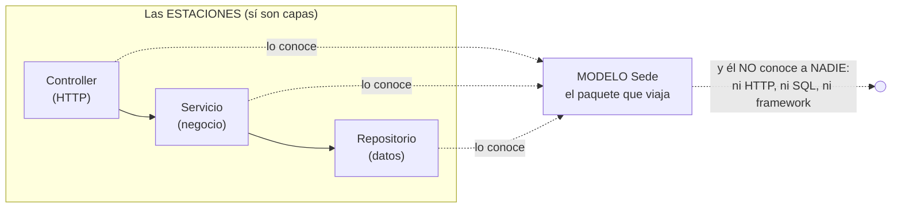

# SOLID, programación por capas y patrones de diseño — en este proyecto

> Documento conceptual del curso: los 5 principios SOLID, la arquitectura
> por capas y los patrones de diseño que este código usa, cada uno con su
> ejemplo REAL en la versión en curso — y en qué versión se termina de
> demostrar.

---

## 1. Programación por capas (la arquitectura del proyecto)

Organizar el sistema en **niveles con responsabilidades distintas**, donde
cada capa solo conoce a la inmediatamente inferior y siempre a través de un
contrato. Así se ve el **viaje de UNA petición** por dentro de la API — el
"diagrama de palitos" del curso:

```
            EL CLIENTE (navegador, Swagger, curl)
                 │
                 │  ① GET /api/sede/PR001
                 ▼
┌─────────────────────────────────────────────────────┐
│ CAPA 1 — CONTROLLER (HTTP)                          │
│ Controllers/SedeController.cs                   │
│ Recibe la petición (el framework ya validó el body  │
│ contra la petición del verbo) y traduce el          │
│ resultado a códigos HTTP y JSON. NO tiene negocio.  │
│ NO tiene SQL.                                       │
└────────────────┬────────────────────────────────────┘
                 │  ② _servicio.ObtenerPorCodigoAsync("PR001")
                 ▼
┌─────────────────────────────────────────────────────┐
│ CAPA 2 — SERVICIO (negocio)                         │
│ Servicios/ServicioSede.cs                       │
│ Las reglas del dominio: qué se puede y qué no (el   │
│ 404 "no existe" NACE aquí). NO conoce ASP.NET.      │
│ NO sabe qué motor hay debajo.                       │
└────────────────┬────────────────────────────────────┘
                 │  ③ _repositorio.ObtenerPorCodigoAsync("PR001")
                 │     — a través de la INTERFAZ IRepositorioSede
                 ▼
┌─────────────────────────────────────────────────────┐
│ CAPA 3 — REPOSITORIO (datos)                        │
│ Repositorios/RepositorioSedePostgreSql.cs        │
│ El SQL a mano (Dapper): traduce filas ↔ objetos     │
│ Sede. NO conoce HTTP. NO decide negocio.        │
└────────────────┬────────────────────────────────────┘
                 │  ④ SELECT … FROM sede WHERE codigo = @codigo
                 ▼
          ┌───────────────┐
          │ BASE DE DATOS │  SQL Server — catedras_local
          └───────┬───────┘
                  │
   y la respuesta hace el viaje DE VUELTA:
   fila → objeto Sede (repositorio) → objeto (servicio)
        → JSON + 200 (controller) → cliente
```

Qué hace — y qué tiene PROHIBIDO — cada capa:

| Capa | Su trabajo | Prohibido para ella | En la v1 |
|---|---|---|---|
| **Controller** | HTTP: rutas, códigos de estado, JSON | SQL y reglas de negocio | `Controllers/SedeController.cs` |
| **Servicio** | Las reglas del negocio (¿existe? ¿se puede?) | Saber de HTTP o del motor de BD | `Servicios/ServicioSede.cs` |
| **Repositorio** | El SQL y el mapeo fila ↔ objeto | Saber de HTTP o decidir negocio | `Repositorios/RepositorioSedePostgreSql.cs` |

**La regla:** las dependencias apuntan en una sola dirección y cruzan por
**interfaces**. El controller conoce al servicio; el servicio conoce la
interfaz del repositorio; **nadie** conoce dos capas hacia abajo (el
controller no sabe que existe SQL Server).

**El mismo viaje cuando algo sale mal** — `GET /api/sede/PR999`:

1. El **repositorio** no encuentra la fila y devuelve `null` — un HECHO,
   sin opinión.
2. El **servicio** decide qué significa ese hecho: "ese sede no
   existe" — y lo dice lanzando `NoEncontradoExcepcion` (una DECISIÓN de
   negocio).
3. El **controller** captura la excepción y la traduce al idioma HTTP:
   **404** con su JSON.

Cada capa aportó exactamente lo suyo: datos → hecho, negocio → decisión,
HTTP → código de estado.

**¿Para qué?** Cada capa se puede cambiar, probar y entender POR SEPARADO.
La prueba viviente en la v1: `pruebas/` corre el servicio real con un
repositorio falso en memoria — sin BD. Eso solo es posible porque las capas
están bien cortadas.

### 1.1 ¿Y los MODELOS? ¿Por qué no aparecen como capa?

Pregunta legítima: la carpeta de modelos (`Modelos/Sede.cs`) existe en el
proyecto, pero la tabla de capas no la menciona. ¿Se olvidó? No — **el
modelo NO es una capa, y la diferencia ES la lección:**

- Las **capas son las ESTACIONES del viaje**: cada una le HACE algo a la
  petición (el controller traduce HTTP, el servicio decide, el
  repositorio consulta).
- El **modelo es LO QUE VIAJA entre estaciones**: el repositorio arma un
  `Sede` desde la fila, el servicio lo razona, el controller lo
  vuelve JSON. No procesa nada: ES el paquete. Por eso el diagrama de
  palitos no lo pinta como caja — el modelo va implícito en las flechas.



**Guía de lectura:** las tres estaciones lo conocen y él no conoce a
ninguna — a eso se le llama un elemento **transversal**. No viola la regla
de dependencias ("cada capa solo conoce a la de abajo") porque conocer un
modelo no acopla a nada: el modelo no arrastra dependencias, solo trae
datos con tipos.

**¿Entonces para qué se necesita?** Es el **idioma común** del sistema —
el contrato interno entre capas. Sin modelo, las capas se pasarían
diccionarios sueltos sin tipos, y el error de escribir `stok` en vez de
`nombre` no lo atraparía nadie hasta producción. Con modelo, lo atrapa el
lenguaje. En C#, además, `Modelos/` (la entidad) convive con `Peticiones/` (los
DTO por verbo): la entidad es el dato como ES; la petición, como LLEGA —
la distinción completa está en [PARADIGMA_POO.md](PARADIGMA_POO.md) §3.

**La regla del modelo** (tan estricta como las de las capas): el modelo
tiene PROHIBIDO importar cosas del proyecto — ni HTTP, ni SQL, ni
conexiones. Sus flechas de dependencia solo ENTRAN; jamás SALEN.

## 2. Antes de SOLID: **cohesión** y **acoplamiento**

Estos dos son de 1974 y SOLID es de los años noventa. **Van primero porque
SOLID los persigue**: cada una de las cinco letras es una forma de subir la
cohesión o de bajar el acoplamiento. Quien aprende SOLID sin esto lo memoriza;
quien los aprende antes, lo deduce.

### Cohesión — cuánto tiene que ver una cosa consigo misma

> **Un módulo es cohesivo cuando todo lo que tiene dentro sirve al mismo
> propósito.**

| Cohesión | Qué se ve |
|---|---|
| **Alta** ✅ | `RepositorioSedePostgreSql` solo hace SQL de `sede`. Todo lo de adentro sirve a eso |
| **Baja** ❌ | Una clase `Utilidades` con formatear fechas, validar correos y abrir conexiones. **Lo único que comparten es que nadie supo dónde ponerlos** |

**La prueba, en una pregunta:** *¿puede describir lo que hace la clase **sin
usar la palabra «y»**?* Si necesita el «y», la cohesión está baja.

### Acoplamiento — de cuántas cosas depende para funcionar

> **Dos módulos están acoplados cuando un cambio en uno obliga a cambiar el
> otro.**

Y hay grados, no es sí o no:

| Grado | Qué significa | En este proyecto |
|---|---|---|
| **Por datos** ✅ | Le paso lo que necesita y nada más | `Listar(limite)` |
| **Por estructura** | Le paso un objeto y solo usa dos campos | Un `SedeCrear` completo cuando bastaba el nombre |
| **De control** | Le paso una bandera que le dice **qué rama tomar** | `Guardar(sede, esNuevo: true)` |
| **Común** ❌ | Los dos tocan el mismo estado global | Una variable compartida |
| **De contenido** ❌ | Uno mete la mano en las tripas del otro | El controlador abriendo la conexión del repositorio |

> **El acoplamiento de control es el más disfrazado.** Un parámetro booleano que
> decide el camino de adentro significa que **quien llama sabe cómo funciona el
> llamado** — y el día que haya un tercer caso, el booleano se vuelve un entero
> y nadie recuerda qué es el 2.

### Y la frase que las une

> **Alta cohesión, bajo acoplamiento.** Es el objetivo; SOLID es el medio.

**Y no son independientes:** partir una clase para subir la cohesión **sube el
acoplamiento**, porque ahora son dos que se hablan. Lo que se busca no es el
máximo de una: es **el punto donde el conjunto se entiende y se cambia sin
miedo**.

> **La raíz es más vieja todavía.** Parnas lo dijo en 1972 con otra palabra:
> un módulo se define por **lo que esconde**. Cohesión y acoplamiento son la
> forma de medir si esconde bien.

---

## 3. Los 5 principios SOLID, uno por uno

### S — Responsabilidad única (Single Responsibility)
Cada clase tiene UNA razón para cambiar: el controller si cambia el
protocolo HTTP; el servicio si cambian las reglas de negocio; el
repositorio si cambia el SQL; las peticiones del verbo si cambian las reglas
de forma del body. Ninguna clase hace dos de esas cosas.

```csharp
// ❌ Sin S: un "controller" con tres razones de cambio (HTTP + negocio + SQL)
[HttpGet("{codigo}")]
public async Task<IActionResult> Obtener(string codigo)
{
    await using var conexion = new SqlConnection(...);   // SQL aquí = mezcla
    // ...y el if de "¿existe?" aquí = negocio mezclado
}

// ✅ Con S (la v1): un archivo por razón de cambio
//   Controllers/   → cambia solo si cambia el HTTP
//   Servicios/     → cambia solo si cambian las reglas
//   Repositorios/  → cambia solo si cambia el SQL
//   Peticiones/    → cambia solo si cambian las reglas del body
```

### O — Abierto/Cerrado (Open/Closed)
Abierto a extensión, cerrado a modificación. **El examen llega con el
segundo motor (la v4 del mapa del curso)**: agregar PostgreSQL debe ser
AGREGAR clases (`RepositorioSedePostgres : IRepositorioSede`) y
tocar SOLO el ensamblador — sin modificar controller, servicio ni la
interfaz.

```csharp
// La v4 AGREGA sin modificar: una clase nueva con la misma interfaz...
public class RepositorioSedePostgres : IRepositorioSede { /* … */ }

// ...y el ensamblador (Program.cs, ÚNICO archivo tocado) elige el motor
// en UN solo punto — la fábrica de repositorios (ver §3, patrones):
IFabricaRepositorios fabrica = motor switch
{
    "sqlserver" => new FabricaSqlServer(cadenaSqlServer),
    "postgres"  => new FabricaPostgres(cadenaPostgres),
    _ => throw new InvalidOperationException($"Motor desconocido: '{motor}'."),
};
```

### L — Sustitución de Liskov
Cualquier implementación de la interfaz puede ocupar el lugar de otra sin
romper nada. Ya pasa en la v1: `RepositorioFalsoEnMemoria` sustituye a
`RepositorioSedePostgreSql` en las pruebas y el servicio ni se entera.

```csharp
// El repositorio FALSO de las pruebas (criterio 6): sin BD, misma interfaz
public class RepositorioFalsoEnMemoria : IRepositorioSede
{
    private readonly Dictionary<string, Sede> _datos = new();

    public Task<Sede?> ObtenerPorCodigoAsync(string codigo)
        => Task.FromResult(_datos.GetValueOrDefault(codigo));
    // ...los otros 4 métodos...
}

// y el servicio NI SE ENTERA:
var servicio = new ServicioSede(new RepositorioFalsoEnMemoria());
```

### I — Segregación de interfaces
Interfaces pequeñas y específicas: `IRepositorioSede` tiene SOLO los 5
métodos de datos de sede — no un "IRepositorioDeTodo" que obligue a
implementar métodos que no se usan.

```csharp
// ✅ La interfaz de la v1: SOLO los 5 métodos de datos de sede
public interface IRepositorioSede
{
    Task<List<Sede>> ObtenerTodosAsync(int limite);
    Task<Sede?> ObtenerPorCodigoAsync(string codigo);
    Task CrearAsync(Sede sede);
    Task<int> ActualizarAsync(string codigo, Dictionary<string, object> datos);
    Task<int> EliminarAsync(string codigo);
}

// ❌ El anti-ejemplo: un "IRepositorioDeTodo" de 40 métodos que obliga a
//    implementar lo que no se usa.
```

### D — Inversión de dependencias
Las capas de arriba dependen de ABSTRACCIONES, no de clases concretas:

```csharp
public ServicioSede(IRepositorioSede repositorio)  // ← interfaz, no clase
```

Solo el **ensamblador** (la sección de DI en `Program.cs`) conoce las
clases concretas. Eso es literalmente "invertir" la dependencia: el detalle
(SQL Server) depende del contrato, no al revés.

## 4. CUPID — el contrapeso de SOLID, y por qué vale la pena

**Dan North publicó CUPID en 2022**, y su punto de partida es incómodo y justo:
**SOLID se volvió un catecismo que se recita sin entender**. Se enseña, se
repite en entrevistas, y casi nadie sabría decir qué se gana y qué se pierde
al aplicar cada letra.

### La idea que lo cambia todo: **propiedades**, no principios

> *«Los principios son como reglas: o las cumples o no las cumples.»*
> — Dan North

Y de ahí sale la propuesta:

| | **Principio** | **Propiedad** |
|---|---|---|
| Qué es | Una **regla** | Una **cualidad** |
| Cómo se evalúa | Se cumple o no se cumple — **blanco o negro** | Se está **más cerca o más lejos** |
| Qué le dice a usted | Que está infringiendo algo | **Hacia dónde moverse** |

**Una propiedad define un centro hacia el cual moverse.** Nunca se alcanza del
todo, y eso no es un fracaso: siempre hay **una dirección clara de viaje**.

> **Por qué esto importa en un curso:** un estudiante al que se le dice «esto
> viola el principio de responsabilidad única» **aprende a esconder la
> infracción**. Uno al que se le dice «esto está lejos de hacer una sola cosa»
> aprende **hacia dónde moverlo**.

### Las cinco propiedades

| | Propiedad | Qué quiere decir |
|---|---|---|
| **C** | **Composable** — *se combina bien* | **Se lleva bien con otros**: superficie pequeña, pocas dependencias, y un nombre que revela la intención |
| **U** | **Unix philosophy** — *filosofía Unix* | **Hace una cosa y la hace bien**, con un modelo simple y consistente |
| **P** | **Predictable** — *predecible* | **Hace lo que uno espera**: determinista, observable, **sin sorpresas desagradables** |
| **I** | **Idiomatic** — *idiomático* | **Se siente natural**. Le resulta familiar aunque nunca lo haya visto |
| **D** | **Domain-based** — *del dominio* | **Acorta la distancia mental entre la necesidad y la solución**: el código habla como habla el negocio |

### Las cinco, con código

**Fíjese en que ninguna pareja es «bien» y «mal»:** es **lejos del centro** y
**cerca del centro**. Esa es toda la diferencia con un principio.

---

#### C · Composable — se lleva bien con otros

```csharp
// LEJOS
public async Task<List<Sede>> Listar(HttpContext contexto, int? limite)

// CERCA
public async Task<List<Sede>> Listar(int? limite)
```

**Primero, por qué el primero parece inofensivo.** Porque **lo es, mientras se
esté escribiendo dentro de un controlador**: ahí el `HttpContext` está a mano,
pasarlo no cuesta nada y se ve natural. **Este defecto no se comete por
descuido: se comete porque en el sitio donde se escribe, se ve bien.**

**Qué es `HttpContext`.** Un objeto que **solo existe dentro de una petición
web**: lo crea el servidor cuando llega una petición, y lleva la URL, las
cabeceras y las cookies. Si un método lo **exige**, solo se puede llamar desde
una petición web — no porque alguien lo prohíba, sino porque **nadie más tiene
uno que darle**.

**Y aquí está el punto, que no es evidente:** el `HttpContext` **no es un dato
que usted invente**. Es algo que **le entrega el servidor web**. Si no hay
servidor web corriendo, **no hay de dónde sacarlo** — no es que sea difícil, es
que no existe.

Y eso se ve cuando uno se sienta a escribir el segundo llamador.

##### Lo que pasa de verdad, en un archivo de este proyecto

Abra `api_catedras/pruebas/Programa.cs`. En la **línea 214** hay esto, y es
código real que corre hoy:

```csharp
IServicioSede sedes = new ServicioSede(new RepositorioSedeDeMentiras());
```

Esa prueba **arranca sin servidor web**: es un programa de consola que crea el
servicio, le mete un repositorio de mentiras y comprueba que las reglas
funcionan. Por eso puede correr sin base de datos y sin API.

Ahora usted quiere probar el listado, y escribe la línea siguiente:

```csharp
// Con la firma BUENA — sale solo:
var lista = await sedes.Listar(50);

// Con la firma MALA — se traba aquí:
var lista = await sedes.Listar(  ????  , 50);
//                               ^^^^^^
//              ¿Qué escribe ahí? No hay servidor web corriendo.
//              No hay petición. No hay HttpContext que pasarle.
```

**Ese hueco es el defecto.** No es un error de compilación rebuscado: es que
usted, sentado, **no tiene qué escribir ahí**. Y sus opciones son las dos
malas:

1. **Fabricar un `HttpContext` falso** solo para rellenar el hueco — un
   `DefaultHttpContext` vacío, que no se usa para nada.
2. **No probar el listado**, que es la que se elige casi siempre.

**Lo mismo pasa con el tercer llamador.** El día que haya un cargue por lotes
—un programa que corre a las 2 de la mañana y actualiza catálogos— tampoco hay
petición web, y se traba igual.

**Resumido:**

| Quién llama a `Listar` | ¿Tiene un `HttpContext`? |
|---|---|
| El controlador, atendiendo una petición | **Sí**, se lo dio el servidor |
| La prueba de capas, que es consola | **No** |
| Un cargue por lotes de madrugada | **No** |

**Dos de tres no pueden.** Con `Listar(int? limite)` los tres pueden, porque
**un número lo tiene cualquiera**.

**Y en la prueba el costo es visible:** para probar `Listar` habría que
construir un `DefaultHttpContext` entero **solo para satisfacer la firma** —
cuando el método **no lee ni un dato de él**. Ese andamiaje que no prueba nada
es la señal más clara de que el parámetro sobra.

Con `Listar(int? limite)` los tres llamadores funcionan, porque **un número lo
tiene cualquiera**.

##### ¿Y si el servicio SÍ necesita algo de la petición?

Es la pregunta que sigue, y la respuesta **no** es «entonces sí pásele el
`HttpContext`». Hay dos caminos, y los dos conservan la propiedad:

```csharp
// 1 · Extraer SOLO lo que necesita. El controlador saca el dato y lo pasa.
public async Task<List<Sede>> Listar(string usuarioId, int? limite)

// 2 · Si lo necesita a menudo, una abstracción por constructor:
//     el servicio pide «quién es el usuario», no «la petición web».
public ServicioSede(IRepositorioSede repositorio, IUsuarioActual usuario)
```

> **La diferencia entre las dos y el `HttpContext`:** `string usuarioId` y
> `IUsuarioActual` **los puede fabricar cualquiera** — el cargue por lotes pasa
> el usuario del proceso, la prueba pasa uno inventado. El `HttpContext` no.
>
> Y la segunda tiene un valor extra: **el servicio declara qué necesita
> saber**. «Quién es el usuario» es una necesidad del negocio; «la petición
> HTTP» es un detalle de cómo llegó.

> **La señal, en una pregunta:** *¿desde cuántos sitios distintos puedo llamar
> esto?* El primero sirve en uno. El segundo, en tres. **Eso es componer.**

---

#### U · Filosofía Unix — hace una cosa y la hace bien

```csharp
// LEJOS. Hace tres: consulta, formatea y avisa. El nombre lo delata:
// para describirlo hay que usar la palabra «y».
public async Task<string> ObtenerSedeYFormatearYNotificar(string codigo)

// CERCA. Tres piezas, cada una con un propósito, que se componen.
public async Task<Sede> ObtenerPorId(string codigo)
```

> **Y aquí se ve el matiz de la sección siguiente:** *hace una cosa* se puede
> **mirar**; *tiene una sola razón para cambiar* hay que **deducirlo**.

---

#### P · Predecible — hace lo que uno espera

```csharp
// LEJOS. Se llama Obtener y además escribe: cambia el estado del sistema
// en un método que el lector supone que solo consulta.
public async Task<Sede> Obtener(string codigo)
{
    var sede = await _repositorio.ObtenerPorId(codigo);
    await _repositorio.RegistrarUltimoAcceso(codigo);   // ← sorpresa
    return sede;
}

// CERCA. Consultar consulta. Si hay que registrar el acceso, es otra
// operación y se llama aparte.
public async Task<Sede> Obtener(string codigo)
    => await _repositorio.ObtenerPorId(codigo);
```

**Esto es CQS**, y es el mismo principio: *o devuelve algo o cambia algo*.

---

#### I · Idiomático — se siente natural

```csharp
// LEJOS. Es C# escrito con la cabeza en otro lenguaje: nombres en
// minúscula_con_guiones, y un booleano devuelto como entero.
public int obtener_sede_activa(string codigo_sede)

// CERCA. Es C# como lo escribe quien escribe C#.
public async Task<Sede?> ObtenerActiva(string codigo)
```

> **Idiomático es relativo a un sitio**, y por eso este proyecto está a medias:
> **los nombres en español no son idiomáticos en C#** — la biblioteca estándar
> está en inglés, y el código mezcla `Task<Sede>` con `ObtenerPorId`. Se eligió
> a conciencia, porque el curso es en español y el estudiante tiene que leer su
> propio código sin traducir. **Es una decisión, no un descuido**, y CUPID
> obliga a decirlo.

---

#### D · Del dominio — acorta la distancia entre la necesidad y la solución

Esta es la que este proyecto no cumple, y el ejemplo lo muestra mejor que la
explicación.

```csharp
// LEJOS —y es lo que hay hoy—. El negocio dice «retirar una sede del
// catálogo»; el código dice «borrar una fila y marcar un booleano».
await _servicio.Actualizar(codigo, new SedeActualizar { Activo = false });

// CERCA. El método se llama como la necesidad, y quien lea el código
// entiende el negocio sin preguntar.
await _servicio.RetirarDelCatalogo(codigo);
```

**La distancia mental es la métrica.** En el primero, quien lee tiene que
traducir *«activo = false»* a *«retirada»*. En el segundo no traduce nada.

> **Y ahí está por qué un CRUD puntúa bajo en esta propiedad:** `Crear`,
> `Listar`, `Actualizar` y `Eliminar` son los verbos **de la tabla**, no los
> del negocio. El negocio no dice «actualizar una sede»: dice «cambiarle la
> dirección», «retirarla», «reabrirla». **Son tres operaciones distintas que el
> CRUD colapsa en una**, y al colapsarlas pierde la intención.
>
> **Para la v1 es correcto** —lo que se enseña es el patrón de capas, no el
> modelado del dominio—. Pero conviene saber qué se dejó por el camino.

---

### El matiz más fino, y el que más enseña

> **«Un solo propósito» no es lo mismo que «una sola responsabilidad».**

La **U** de CUPID dice *hacer una cosa bien*. La **S** de SOLID dice *una sola
razón para cambiar*. Suenan igual y no lo son: la de SOLID se define **por quién
pide el cambio**, y la de Unix **por lo que la pieza hace**. La segunda se puede
mirar; la primera hay que deducirla.

### Cómo se ve este proyecto medido con CUPID

Es más útil que la lista, porque **no sale todo aprobado**:

| Propiedad | Cómo está | Por qué |
|---|---|---|
| **Composable** | 🟢 Bien | Cada recurso es un juego cerrado de siete archivos. Se puede quitar uno sin tocar los otros nueve |
| **Unix philosophy** | 🟢 Bien | El repositorio hace SQL; el servicio, reglas; el controlador, HTTP. Nadie hace dos cosas |
| **Predictable** | 🟡 A medias | `PUT` y `PATCH` se comportan distinto **a propósito** y eso es correcto — pero **es exactamente donde el lector se sorprende**, y por eso hay que documentarlo tanto |
| **Idiomatic** | 🟡 A medias | El C# es idiomático; **el español en los nombres no lo es** para quien viene de fuera. Se eligió a conciencia: el curso es en español |
| **Domain-based** | 🔴 Flojo | **La distancia mental es larga**: el negocio dice «cátedra», «sede», «asistente», y el código dice `Listar`, `Crear`, `Reemplazar`. Un CRUD **no habla el idioma del dominio**, y eso es una limitación real de esta versión |

> **La fila roja es la más honesta del documento.** Este sistema es un CRUD, y
> un CRUD es **lo contrario** de estar basado en el dominio: hace las cuatro
> operaciones de una tabla en vez de las operaciones que el negocio nombra
> —«programar una cátedra», «retirar un productor»—. **Está bien para la v1**,
> donde lo que se enseña es el patrón; y es lo primero que habría que cambiar
> el día que este sistema tuviera que crecer de verdad.

### Qué hacer con los dos

**No se elige entre SOLID y CUPID.** Sirven para momentos distintos:

| | Cuándo sirve |
|---|---|
| **SOLID** | **Al diseñar**: son cinco preguntas concretas que hacerle a una clase antes de escribirla |
| **CUPID** | **Al revisar**: son cinco direcciones hacia las que empujar código que ya existe |

> **Y lo que CUPID aporta a este curso, aunque no se adopte:** obliga a
> preguntar **qué se gana** con cada principio, no solo si se cumple. Enseñar
> SOLID sin su crítica más conocida **es enseñarlo como dogma** — y este
> documento acaba de decir, en la sección anterior, que un principio que nunca
> se sacrifica no se está aplicando: se está obedeciendo.

---

## 5. Los principios cortos: **DRY, KISS, YAGNI** y la ley de Demeter

Son cuatro frases, y **las cuatro se citan mal**. Vale la pena decir qué
significan de verdad, porque las cuatro gobiernan decisiones de este proyecto.

### DRY — *Don't Repeat Yourself*

> **No se trata de no repetir código: se trata de que cada pieza de
> CONOCIMIENTO tenga un solo sitio donde vive.**

Esa distinción lo decide todo. Dos trozos de código idénticos **por
casualidad** no violan DRY: unificarlos crea un acoplamiento falso, y el día
que uno tenga que cambiar y el otro no, el arreglo es peor que la repetición.

> **El caso de este proyecto, y es el más incómodo:** los diez repositorios se
> parecen mucho. ¿Eso viola DRY? **No.** Cada uno tiene sus columnas, sus
> restricciones y sus operaciones — el parecido es **de forma**, no de
> conocimiento. Las cinco diferencias reales entre los diez recursos
> —documentadas en `D-v1-1`— solo existen **porque hay archivos propios**.
>
> Esa discusión está completa en
> `4_research.md`, y es
> el mejor ejemplo del repositorio de que **un principio no se aplica en
> automático: se pondera.**

### KISS — que sea simple

> **Simple no es corto.** Es que quien lo lea **entienda qué hace sin tener que
> reconstruirlo en la cabeza**.

Una línea con tres operadores encadenados es corta y no es simple. Diez líneas
con nombres claros son largas y simples.

### YAGNI — *You Aren't Gonna Need It*

> **No construya lo que todavía no le han pedido.**

**Este proyecto lo aplica sin nombrarlo cada vez que la constitución dice «no
agregue nada que la especificación no pida»** (Artículo 1). Y la regla de que
*el código de una versión no anticipa a la siguiente* es YAGNI con otro nombre.

> **La versión difícil de YAGNI**, y la que de verdad cuesta: no es no escribir
> la función que nadie pidió. Es **no dejar el hueco preparado** — la interfaz
> con un método de más, el parámetro que «por si acaso», la tabla con una
> columna vacía. Eso también es construir lo que no le pidieron, y encima es
> invisible.

### La ley de Demeter — hable solo con sus vecinos

> **Un objeto solo debería llamar a: lo suyo, lo que recibió como parámetro, y
> lo que él mismo creó.** No a los amigos de sus amigos.

La señal es un **tren de puntos**:

```csharp
// Viola Demeter: el controlador conoce la estructura interna de tres cosas
var ciudad = servicio.Repositorio.Conexion.Configuracion.Ciudad;

// La cumple: le pregunta a quien le corresponde saberlo
var ciudad = servicio.ObtenerCiudad();
```

**Por qué importa aquí:** ese tren significa que el controlador **conoce las
tripas del repositorio**. El día que el repositorio cambie por dentro, rompe al
controlador — que no tenía por qué enterarse.

> **Y es una ley con excepción declarada:** las cadenas fluidas —los
> `.Where().Select().ToList()`— encadenan puntos y **no violan Demeter**,
> porque cada llamada devuelve **la misma cosa**, no un vecino nuevo.

---

## 6. Otros principios que este proyecto ya aplica **sin nombrarlos**

Vale la pena ponerles nombre: lo que tiene nombre se puede discutir.

| Principio | Qué dice | Dónde vive en este código |
|---|---|---|
| **Separación de intereses** · Dijkstra, 1974 | Estudiar un aspecto a la vez, aislado de los demás | **Las tres capas son esto.** Es el principio del que cuelga toda la arquitectura |
| **Experto en información** · GRASP | La responsabilidad va donde están los datos para cumplirla | El repositorio sabe SQL porque **es el único que tiene la conexión** |
| **Controlador** · GRASP | Un objeto que recibe el evento del sistema y lo delega | `SedeController` **es** ese patrón, con ese nombre |
| **Fabricación pura** · GRASP | Una clase que **no existe en el dominio**, inventada para tener dónde poner algo | `ServicioSede`. En el negocio no hay «servicios de sede»: hay sedes |
| **Variaciones protegidas** · GRASP | Poner una interfaz donde se espera que algo cambie | `IRepositorioSede`, porque el motor puede cambiar |
| **CQS** · Meyer | Un método **o devuelve algo o cambia algo**, nunca las dos | **`GET` frente a `POST/PUT/PATCH/DELETE` es CQS sobre HTTP.** Y explica la excepción documentada: `Crear` devuelve `Task<long>` solo en `encuesta`, porque la base asigna la llave |
| **Diseño por contrato** · Meyer | Precondiciones, poscondiciones e invariantes | Las interfaces son el contrato; **las tres clases de petición son precondiciones tipadas** |
| **Composición sobre herencia** · GoF, 1994 | Componer antes que heredar | Aquí es literal: interfaces y `Protocol`, **herencia cero** |
| **Fallar rápido** | Rechazar lo inválido lo antes posible | **El 422 lo pone el framework antes de entrar al método** |
| **Mínima sorpresa** | Que se comporte como el lector espera | Por eso `PUT` y `PATCH` **tienen que** comportarse distinto: si hicieran lo mismo, el nombre mentiría |
| **Mínimo privilegio** · Saltzer y Schroeder, 1975 | Cada programa opera con **los permisos mínimos** para su tarea | El usuario de base de datos de la API. Y es de donde nace la v3 |

### Y tres que conviene conocer aunque no se apliquen aquí

| | |
|---|---|
| **Ley de Conway** · 1968 | *La arquitectura del sistema copia la estructura de comunicación de quien lo construye.* **En un curso por equipos esto se ve**: si dos personas no se hablan, sus módulos tampoco |
| **Complejidad esencial y accidental** · Brooks, 1986 | *No Silver Bullet.* Es **el mejor marco para discutir qué resuelve la IA y qué no**: ataca la accidental —escribir el código— y no la esencial —decidir qué hay que construir— |
| **Principios de paquetes** · Martin | SOLID es para clases; estos son para **módulos**: reutilización, cierre común, dependencias acíclicas. Es el nivel que a este proyecto todavía le falta nombrar |

---

## 7. Los principios se pelean, y hay que ponderar

Esto es lo que casi nunca se enseña, y es lo que separa aplicar principios de
obedecerlos.

| Tensión | Cómo se manifiesta | Cómo se resolvió aquí |
|---|---|---|
| **DRY ↔ acoplamiento** | Unificar diez repositorios quita repetición **y ata los diez recursos entre sí** | Se eligió **no unificar**, con las cifras en `D-v1-1` |
| **KISS ↔ abierto/cerrado** | Preparar la extensión **complica el código de hoy** | Se eligió KISS: el patrón se generaliza **cuando aparece el segundo caso**, no antes |
| **YAGNI ↔ la fábrica abstracta** | La fábrica es para la v4, y **existe desde antes** | Se declara como deuda consciente, no se esconde |
| **Segregación de interfaces ↔ cohesión** | Partir una interfaz en tres sube la cohesión **y multiplica los archivos** | Se partió solo donde había un cliente que no usaba todo |

> **La regla, si hay que resumirla en una línea:** un principio que nunca se
> sacrifica **no se está aplicando: se está obedeciendo**. Y lo que hay que
> dejar escrito no es la decisión, sino **qué se sacrificó al tomarla** — que
> es de lo que trata `4_research.md`.

---

## 8. Patrones de diseño (los que trabajan en este proyecto)

**¿Qué es un patrón de diseño?** Una solución **con nombre**, probada y
reutilizable, para un problema de diseño que aparece una y otra vez. No es
código para copiar y pegar: es la FORMA de una solución — qué clases y qué
interfaces participan, y quién conoce a quién — que cada proyecto escribe
en su propio código. El catálogo clásico es el del "Gang of Four" (GoF,
1994): 23 patrones en tres familias — **creacionales** (cómo se construyen
los objetos), **estructurales** (cómo se componen) y **de comportamiento**
(cómo colaboran). Otros, como Repositorio y DTO, vienen del catálogo de
arquitectura empresarial de Fowler (PoEAA, 2002).

La relación con lo anterior: **SOLID dice qué cualidades debe tener el
diseño; los patrones son recetas concretas que las consiguen; las capas
son el plano general donde unos y otras viven.** Y el nombre importa:
decir "esto es una fábrica abstracta" comunica un diseño completo en tres
palabras.

Los que trabajan en este código:

| Patrón | Familia | Dónde vive aquí |
|---|---|---|
| **Repositorio** (Repository) | arquitectónico (PoEAA) | `Repositorios/`: todo el acceso a datos detrás de una interfaz |
| **Inyección de dependencias** | creacional (IoC) | los constructores + el ensamblador de `Program.cs` |
| **DTO** — objeto de petición | arquitectónico (PoEAA) | `Peticiones/`: un objeto por verbo que valida la forma del body |
| **Fábrica abstracta** (Abstract Factory) | creacional (GoF) | llega con el segundo motor (la v4 del curso): la familia completa de repositorios por motor |
| **Estrategia** (Strategy) | comportamiento (GoF) | implícito: implementaciones intercambiables tras cada interfaz |

### Repositorio — el negocio pide datos a un contrato, no a un motor

```csharp
// El contrato (Repositorios/IRepositorioSede.cs):
Task<Sede?> ObtenerPorCodigoAsync(string codigo);

// ServicioSede lo usa SIN saber si detrás hay SQL Server, otro motor
// o un diccionario en memoria (las pruebas). Por eso el segundo motor
// (v4) puede llegar sin tocar una línea del servicio.
```

### Inyección de dependencias — nadie hace `new` de lo que necesita

```csharp
// La dependencia LLEGA por el constructor (una interfaz, no una clase):
public ServicioSede(IRepositorioSede repositorio) { … }

// y el ÚNICO que sabe qué entregar es el ensamblador (Program.cs):
builder.Services.AddScoped<IServicioSede, ServicioSede>();
```

### DTO por verbo — el body aterriza en un objeto que solo valida forma

```csharp
public class SedeCrear
{
    [Required(ErrorMessage = "El campo codigo es obligatorio.")]
    public string? Codigo { get; set; }
    [Range(0, int.MaxValue, ErrorMessage = "El stock no puede ser negativo.")]
    public int? Stock { get; set; }
    // Si no cumple → 422 con errores[] — y el modelo de dominio ni se entera.
}
```

### Fábrica abstracta — UNA decisión, la familia completa (v4)

```csharp
// Así la construye la v4 del curso: un punto del código decide el motor…
IFabricaRepositorios fabrica = motor switch
{
    "sqlserver" => new FabricaSqlServer(cadenaSqlServer),
    "postgres"  => new FabricaPostgres(cadenaPostgres),
    _ => throw new InvalidOperationException($"Motor desconocido: '{motor}'."),
};
// …y la fábrica entrega los repositorios COHERENTES entre sí:
builder.Services.AddScoped<IRepositorioSede>(_ => fabrica.CrearRepositorioSede());
// Agregar un motor cuesta UNA clase y UN case — eso compra el patrón.
```

### Estrategia — el patrón que va de regalo

La pareja "interfaz + implementaciones intercambiables"
(`RepositorioSedePostgreSql`, el falso de las pruebas — y los
repositorios de cada motor que vengan) es la esencia de Strategy. La
elección no cambia en caliente: se hace UNA vez al arrancar — pero el
mecanismo es el mismo: quien usa la interfaz jamás pregunta cuál
implementación le tocó.

## 9. El mapa SOLID ↔ versiones del curso

| Principio | Se ve desde | Se termina de demostrar en |
|---|---|---|
| S | v1 (una clase por responsabilidad) | v2 (más entidades, mismas responsabilidades) |
| O | v1 (la interfaz existe) | **v4** (segundo motor sin tocar lo construido) |
| L | v1 (el repositorio falso de las pruebas) | v4 (motores intercambiables de verdad) |
| I | v1 (interfaces mínimas) | v3 (los puentes: contratos sin verbos que no aplican) |
| D | v1 (constructores reciben interfaces) | v4 (la fábrica reemplaza al ensamblador simple) |

## 10. Referencias

### Científicas

**Fundacionales — los artículos, no los libros que los resumen**

1. **Parnas, D. L.** (1972). «On the Criteria To Be Used in Decomposing Systems
   into Modules». *Communications of the ACM* **15**(12), pp. 1053-1058.
   DOI **`10.1145/361598.361623`**
   — El **ocultamiento de información**, y la idea de que un módulo se define
   por **lo que esconde**, no por lo que hace. Es **anterior a SOLID y lo
   explica**: cuando el repositorio esconde el motor de base de datos detrás
   de una interfaz, esto es lo que está aplicando. Cincuenta años después
   sigue siendo el mejor argumento contra la capa que filtra SQL hacia arriba.
2. **Liskov, B. H.; Wing, J. M.** (1994). «A behavioral notion of subtyping».
   *ACM Transactions on Programming Languages and Systems* **16**(6),
   pp. 1811-1841. DOI **`10.1145/197320.197383`**
   — La **L** de SOLID, en su formulación original y formal. La versión de
   divulgación —«el cuadrado no es un rectángulo»— sale de aquí.
3. **Stevens, W. P.; Myers, G. J.; Constantine, L. L.** (1974).
   «Structured Design». *IBM Systems Journal* **13**(2) — de donde vienen
   **cohesión** y **acoplamiento**, los dos conceptos sobre los que SOLID se
   apoya y que casi nunca se enseñan antes que él.
4. **ISO/IEC 25010:2023** — *Product quality model*. La **mantenibilidad** y
   la **flexibilidad** —que en 2023 reemplazó a *portabilidad*— son las dos
   características que estos principios buscan, y ahí están definidas con sus
   subcaracterísticas.

**Actualizadas — lo que la evidencia dice, que no es solo «sirve»**

5. «Investigating the Impact of SOLID Design Principles on Machine Learning
   Code Understanding». **CAIN 2024**; arXiv **`2402.05337`**
   — Experimento controlado con **100 científicos de datos**, comparando
   código con y sin SOLID. Es de lo poco que **mide** el efecto en la
   comprensión en vez de afirmarlo.
6. «Applying SOLID principles for the refactoring of legacy code: an
   experience report». *ScienceDirect*, **2024** — patrones de refactorización
   aplicados a **más de 5.000 archivos**, con la inversión de dependencias
   como la de mayor efecto.

> **Comprobadas en línea el 14 de septiembre de 2026.** Las que llevan DOI se pueden abrir por el DOI; las de arXiv, por su identificador.

### Los otros principios, con su fuente

7. **Dijkstra, E. W.** (1974). «On the role of scientific thought» — donde
   nombra la **separación de intereses**.
8. **Saltzer, J. H.; Schroeder, M. D.** (1975). «The Protection of Information
   in Computer Systems». *Proceedings of the IEEE* **63**(9), pp. 1278-1308.
   — El **mínimo privilegio**, en su formulación original: *«todo programa y
   todo usuario debe operar con el mínimo conjunto de privilegios necesario
   para cumplir su tarea»*. Casi todo lo que se cita hoy sobre seguridad por
   diseño sale de este artículo.
9. **Larman, C.** — *Applying UML and Patterns*. Los nueve patrones **GRASP**
   de asignación de responsabilidad: experto en información, creador,
   **controlador**, **fabricación pura**, **variaciones protegidas**…
10. **Meyer, B.** — *Object-Oriented Software Construction*. El **diseño por
    contrato** y la **separación consulta/comando (CQS)**.
11. **Conway, M. E.** (1968). «How do committees invent?». *Datamation* — la
    **ley de Conway**.
12. **Brooks, F. P.** (1986). «No Silver Bullet: Essence and Accidents of
    Software Engineering» — **complejidad esencial y accidental**. Es el marco
    con el que conviene discutir qué resuelve la IA y qué no.

### El contrapeso de SOLID

13. **North, D.** (2022). **«CUPID — for joyful coding»**.
    `dannorth.net/2022/02/10/cupid-for-joyful-coding/`
    — Las cinco propiedades —*Composable, Unix philosophy, Predictable,
    Idiomatic, Domain-based*— y la distinción que las sostiene: **los
    principios son reglas que se cumplen o no; las propiedades son un centro
    hacia el cual moverse**. Su frase: *«Los principios son como reglas: o las
    cumples o no las cumples.»*
    **Léalo después de SOLID, no en vez de SOLID.**

### De gurús, blogs y fuentes primarias

1. Martin, R. — *Design Principles and Design Patterns* (el texto original
   de SOLID).
2. Gamma, Helm, Johnson y Vlissides — *Design Patterns* (GoF, 1994): el
   catálogo original de los 23 patrones.
3. Fowler, M. — *Patterns of Enterprise Application Architecture* (PoEAA,
   2002): Repositorio, DTO y compañía.
4. Microsoft — Inyección de dependencias en .NET:
   <https://learn.microsoft.com/dotnet/core/extensions/dependency-injection>
3. En este repositorio: [PARADIGMA_POO.md](PARADIGMA_POO.md) (los pilares
   sobre los que SOLID se apoya) y el spec kit de la versión en curso.
