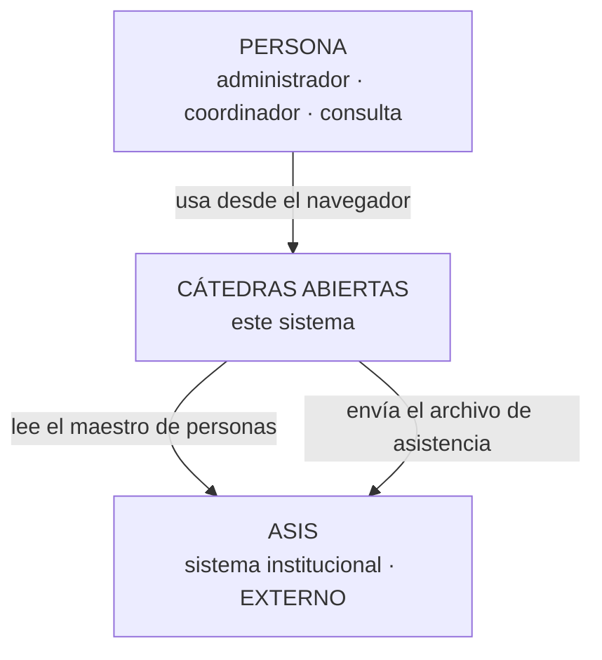
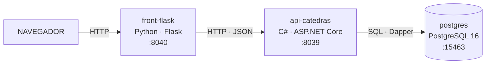
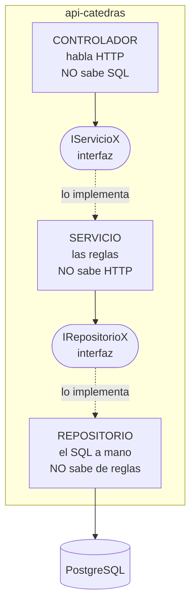
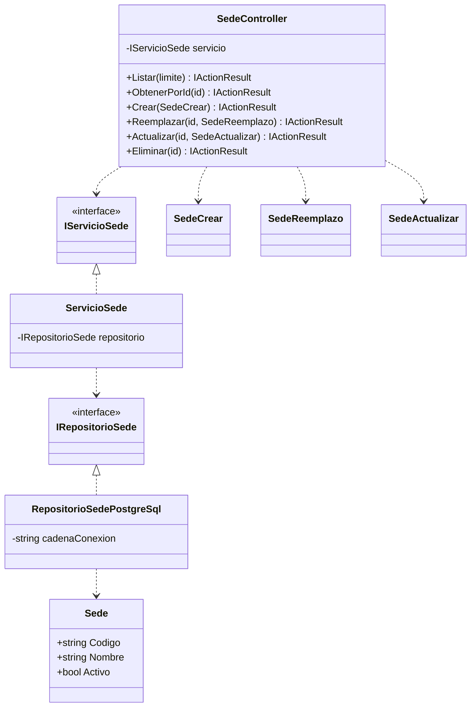
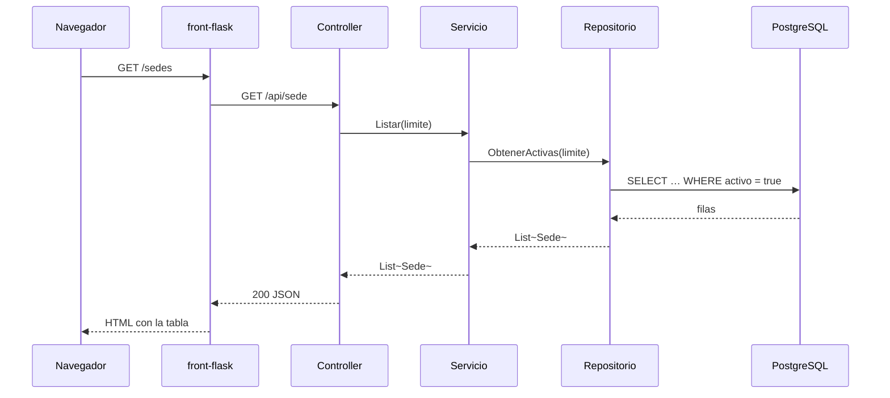
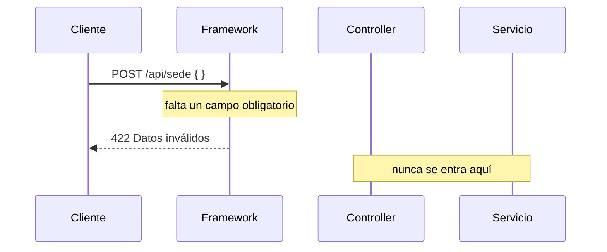
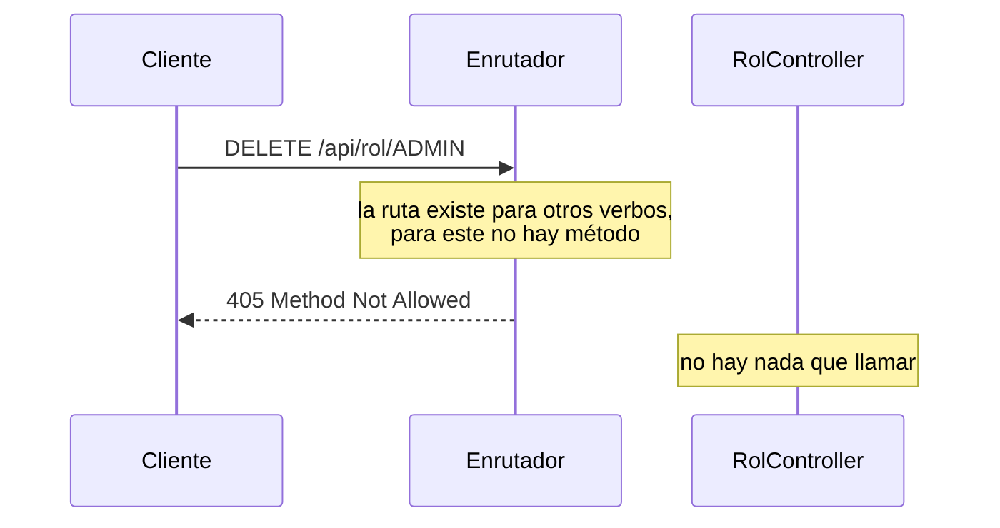
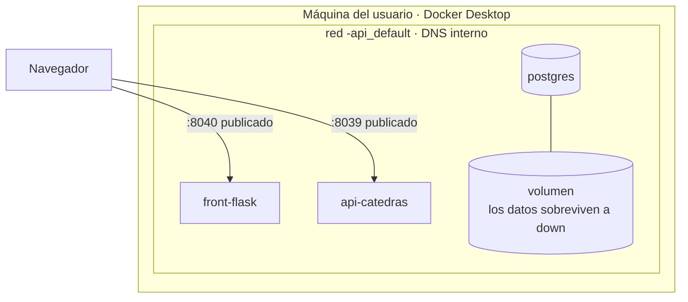

# Arquitectura — Cátedras Abiertas

> **Qué es este archivo.** Cómo está organizado el sistema, **en seis piezas y
> ni una más**, con lo que cada una contesta. Y, tan importante, **lo que no se
> dibuja y por qué**.
>
> **Los principios que la sostienen** están en
> [`../conceptos/SOLID_CAPAS_PATRONES.md`](../conceptos/SOLID_CAPAS_PATRONES.md).
>
> Versión 1.0 · 14 de septiembre de 2026.

---

## 0. La regla que gobierna este documento

> **Si no se va a actualizar, no se dibuja.**

Un diagrama desactualizado **miente con autoridad**: se ve oficial, se cita, y
manda a la gente en la dirección equivocada. Por eso aquí hay **seis piezas**,
elegidas porque cada una contesta una pregunta que las otras no contestan — y
una lista explícita de lo que se decidió **no** dibujar.

---

## 1 · Contexto — quién usa esto y con qué habla



**Lo que este dibujo dice y no es obvio:** el **ASIS es externo y este sistema
no lo modifica**. La relación es de ida y vuelta pero **asimétrica**: de allá
llegan las personas, hacia allá va la asistencia — y nada más.

> **Y una ausencia deliberada:** **no hay flecha del asistente a este sistema**
> en la v1. El registro de la propia asistencia llega en la v4. Dibujarla ahora
> sería prometer algo que no existe.

---

## 2 · Contenedores — las tres piezas que corren



**Tres procesos, tres tecnologías, y una flecha que NO está: del front a la
base de datos.**

> **Esa ausencia es la lección central del proyecto, y se puede verificar**, no
> solo creer:
>
> - `front_flask/requirements.txt` **no tiene** un controlador de PostgreSQL.
> - El front está en **Python** y la API en **C#**: no pueden compartir una
>   clase ni un modelo aunque alguien quisiera.
> - Con la API apagada, el front **sigue en pie** y lo explica (`RNF-13`).
>
> Con front y API en el mismo lenguaje habría que creerlo. **Con dos lenguajes
> distintos, compartir algo es imposible** — y la afirmación pasa de promesa a
> hecho comprobable.

---

## 3 · Componentes — las tres capas, por dentro de la API



**Las flechas punteadas son lo que importa.** El controlador **no conoce** al
servicio: conoce su **interfaz**. Por eso la prueba de capas puede sustituir el
repositorio por uno falso y correr **sin base de datos y sin el paquete del
motor** — y si alguien dejara entrar una dependencia del motor al servicio,
**no compila**.

| Capa | Sabe | **No** sabe | Se comprueba con |
|---|---|---|---|
| Controlador | Rutas, verbos, códigos de estado | SQL, reglas | 0 `SELECT` ni `SqlConnection` en `Controllers/` |
| Servicio | Las reglas de negocio | HTTP, el motor | 0 `IActionResult` ni `[Http…]` en `Servicios/` |
| Repositorio | El SQL de **este** motor | Reglas, HTTP | El SQL está a la vista, parametrizado |

---

## 4 · Clases — **el patrón, una vez**

Esto es lo que se construye por recurso. **Hay diez juegos iguales**, y por eso
se dibuja **uno**.



**Siete archivos por recurso**, más el modelo. Por diez recursos: **noventa
archivos**. Ese número es el costo declarado de la decisión `D-v1-1`, y está
aceptado a sabiendas.

> **Tres clases de petición y no una**, y es la parte que sorprende: `Crear`,
> `Reemplazo` y `Actualizar` tienen **campos distintos y obligatoriedades
> distintas**. `Actualizar` los tiene todos opcionales —es el `PATCH`—; los
> otros dos no. Una sola clase para los tres obligaría a validar a mano lo que
> el framework hace solo.

---

## 5 · Secuencia — **solo los tres casos que enseñan algo**

No hay un diagrama por endpoint. Hay **tres**, elegidos porque cada uno muestra
algo distinto.

### 5.1 · El camino feliz, y dónde muere cada conocimiento



**El HTTP muere en el controlador. El SQL nace en el repositorio.** Entre los
dos, el servicio no sabe ni de uno ni de otro.

### 5.2 · El error de validación — que **no llega al método**



**Este es el diagrama que evita una tarde perdida.** Con `[ApiController]`, el
framework **corta la petición antes** de entrar al método. Quien busque el
error en su código no lo va a encontrar, porque su código no se ejecutó.

### 5.3 · La operación que **no existe**



**Nadie escribió ese 405.** `IServicioRol` **no declara** la operación de baja,
así que no hay método que enrutar. La imposibilidad está **en el tipo**, y un
`if` que respondiera 405 sería peor: alguien podría quitarlo.

---

## 6 · Despliegue — qué corre dónde



**Dentro de la red se llaman por su nombre**, no por dirección: el front pide a
`http://api-catedras:8039`. **Y el volumen es la diferencia entre `down` y
`down -v`**: sin `-v` los datos sobreviven, y `init.sql` **no vuelve a
correr** — que es la causa más común de «cambié el script y no pasó nada».

---

## 7 · Las decisiones, y qué se sacrificó en cada una

Formato de Nygard: contexto, decisión, **consecuencias incluida la que duele**.
El registro completo está en `4_research.md` de cada versión.

| Decisión | Se eligió | Se sacrificó |
|---|---|---|
| **API específica por recurso**, no genérica | Contrato legible, error en compilación | **90 archivos**; un cambio transversal se hace **diez veces** |
| **Dapper, no un ORM** | El SQL a la vista, que es lo que se enseña | Escribir a mano lo que un ORM daría hecho |
| **Front en otro lenguaje** que la API | La separación deja de ser una promesa | Dos entornos, dos formas de depurar |
| **Borrado lógico siempre** | Nada se pierde | La unicidad se complica: un código retirado sigue ocupado |
| **Tres clases de petición** por recurso | El framework valida solo | Agregar un campo obliga a tocar tres clases |

---

## 8. Lo que **no** se dibuja, y por qué

| No se dibuja | Por qué |
|---|---|
| **El diagrama de clases del sistema completo** | Diez recursos × siete archivos. Ilegible, y desactualizado en una semana. Se dibuja **el patrón, una vez** |
| **Un diagrama de secuencia por endpoint** | Sesenta diagramas que dicen lo mismo. Se dibujan **los tres que enseñan algo distinto** |
| **UML completo** | Nadie lo mantiene. Y un diagrama que no se mantiene miente |
| **El diagrama entidad-relación** | **Ya existe**, en el modelo de datos. Repetirlo aquí crea dos verdades que se van a separar |
| **La arquitectura de las versiones futuras** | El Artículo 1 lo prohíbe: **no se anticipa** |

---

## 9. Cómo se comprueba esta arquitectura

No con una lectura: con comandos.

```bash
# 1 · El controlador no sabe SQL
grep -rniE "SELECT |INSERT |SqlConnection|NpgsqlConnection" api_catedras/Controllers/

# 2 · El servicio no sabe HTTP
grep -rniE "IActionResult|\[Http|StatusCode|ControllerBase" api_catedras/Servicios/

# 3 · El front no toca la base de datos
grep -riE "psycopg|postgres|SELECT " front_flask/

# 4 · Las capas están de verdad separadas: la prueba corre SIN el motor
dotnet run --project api_catedras/pruebas/PruebaCapas.csproj
```

> **Las tres primeras tienen que devolver vacío.** La cuarta es la fuerte: si
> el servicio dependiera del motor, **no compilaría**.

---

## 10. Historial

| Versión | Fecha | Qué cambió |
|---|---|---|
| 1.0 | 14 sep 2026 | Primera versión. Recoge en un solo documento los diagramas que estaban sueltos por los `.md` y agrega los que faltaban: contexto, despliegue y los dos casos de secuencia que no eran el camino feliz. La sección 8 —lo que no se dibuja— es tan parte del documento como las otras |
