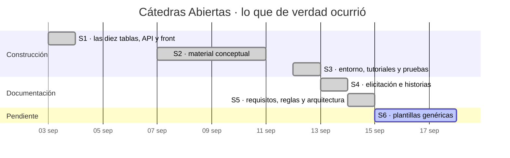

# Cronograma — Cátedras Abiertas

> **Qué es este archivo.** El calendario del proyecto por sprints, y —lo que
> casi nunca se escribe— **lo planeado contra lo real**, con la explicación de
> por qué no coinciden.
>
> **Cómo se planea un proyecto y por qué se compara con lo real:**
> [`../conceptos/CONCEPTOS_PLAN_DE_DESARROLLO.md`](../conceptos/CONCEPTOS_PLAN_DE_DESARROLLO.md).
>
> Versión 1.0 · 14 de septiembre de 2026.

---

## 0. Antes del calendario: la incomodidad que hay que decir

> **Este cronograma está reconstruido hacia atrás**, a partir del historial de
> git. No es el plan que se escribió antes de empezar, porque **ese plan no
> existió**.

Se dice por dos razones:

1. **Un cronograma inventado hacia adelante no enseña nada.** Cualquiera
   escribe seis sprints perfectos en media hora. Lo que enseña es la
   comparación entre lo previsto y lo ocurrido — y para tenerla hace falta que
   lo ocurrido esté registrado.
2. **Aquí sí está registrado**, y con precisión: 68 commits con su fecha y su
   mensaje. El historial de git **es** el registro del proyecto, y por eso los
   mensajes de commit se escriben como se escriben.

**Para el próximo proyecto la regla cambia:** el cronograma se escribe antes, y
este documento sirve de molde — incluida la columna de «lo real», que se llena
al cerrar cada sprint.

### Y una incomodidad más, sobre Scrum

Un proyecto de aula tiene **fechas fijas por calendario académico**. Eso **no
es Scrum**: en Scrum el alcance se ajusta y la fecha no se mueve, pero aquí ni
siquiera el alcance es negociable del todo. Lo que se toma de Scrum es el
**ritmo** —tramos cortos que terminan en algo que se puede mostrar— y no el
marco completo. Disfrazarlo sería mentir sobre el método.

---

## 1. Lo real, contado de git

68 commits entre el **3 y el 14 de septiembre de 2026**.

| Sprint | Fechas | Commits | Qué quedó al final |
|---|---|---|---|
| **S1** | 3 sep | **11** | Las diez tablas sin clave foránea, API y front, corriendo |
| **S2** | 7–10 sep | **2** | El material conceptual del curso, adaptado a este módulo |
| **S3** | 12 sep | **18** | Docker, redes, tutoriales de base de datos, pruebas |
| **S4** | 13 sep | **21** | Elicitación reconstruida de la fuente; historias; spec kit reorganizado |
| **S5** | 14 sep | **16** | La documentación de ingeniería completa |



---

## 2. Lo planeado contra lo real, y qué se aprende

**Esta es la sección que justifica el documento.**

| | Lo que se suponía | Lo que pasó | Qué se aprende |
|---|---|---|---|
| **El código** | La parte gruesa del trabajo | **Un día** (S1) | Con el modelo de datos dado y el patrón claro, **construir es lo rápido** |
| **La documentación** | Un cierre al final | **Tres días de cinco** (S3–S5) | Es **el 60 % del esfuerzo**, y se planeó como si fuera el 10 % |
| **El ritmo** | Constante | 11 · 2 · 18 · 21 · 16 | El S2 se cayó a dos commits: **hubo cuatro días con otras obligaciones**, y el cronograma no las había previsto |
| **El retrabajo** | No previsto | Alto y **productivo** | La renumeración de versiones, la corrupción de texto, la reorganización de `docs/` |

> **El hallazgo que más vale, y es contraintuitivo:** el sprint más
> **productivo** (S4, 21 commits) fue el que **más cosas deshizo** —la
> elicitación se reconstruyó desde la fuente primaria y salieron dos historias
> que faltaban—. **Rehacer no es perder el tiempo cuando lo que se rehace
> estaba mal**; lo que cuesta caro es no enterarse.

---

## 3. La velocidad, y por qué no se puede usar todavía

| Sprint | Commits |
|---|---|
| S1 | 11 |
| S2 | 2 |
| S3 | 18 |
| S4 | 21 |
| S5 | 16 |

**Media: 13,6 commits por sprint.** Y ese número **no sirve para planear**, por
tres razones que hay que decir:

1. **Un commit no es una unidad de trabajo.** Uno arregla una palabra y otro
   escribe cuatro documentos. Contar commits es contar lo que es fácil de
   contar, no lo que importa.
2. **Cinco mediciones son pocas.** Las tres primeras de cualquier proyecto
   **se descartan**: el equipo todavía está aprendiendo el terreno.
3. **Los sprints no son comparables**: S2 duró cuatro días naturales con dos
   commits; S4, uno con veintiuno.

> **Lo que sí se puede decir:** la documentación de ingeniería de un módulo de
> este tamaño **cuesta unos tres días de trabajo concentrado**. Ese número sí
> es útil para el próximo, y es el único que me atrevo a dar.

---

## 4. Lo que falta, y su tramo

| Sprint | Qué | Por qué va al final |
|---|---|---|
| **S6** | **Las plantillas genéricas** — **9** con instrucciones (`1_constitution` y `2_spec` a `9_checklist`), el prompt que las usa, la `GUIA_IA` genérica y la plantilla de segunda versión. `0_historias` y el mapa de versiones **no llevan plantilla a propósito**, y `_plantilla/README.md` dice por qué | **Se destilan** de un kit bien hecho. Antes de tenerlo, se destilaría el hueco |
| **S6** | Probar la **generación con prompt** sobre la documentación ya escrita | Es la prueba de que el camino 2 funciona. **Sin las plantillas no se puede medir**, porque los huecos se calculan con ellas |
| **S7** | Anonimización y traslado del repositorio | Cierre |

---

## 5. Lo que queda abierto y **no tiene fecha**

Se escribe sin fecha a propósito: **poner una fecha falsa es peor que no
ponerla**.

| Pendiente | De quién depende |
|---|---|
| Firmar las **historias 11 a 15** | Del usuario experto |
| Decidir **`D-GLO-1`** (`administrador` / `líder`) y **`D-GLO-2`** (`ponente` / `expositor`) | Del usuario experto |
| Decidir el **409** por edición concurrente | Del equipo |
| Decidir los **dominios de correo** de los datos de prueba | Del equipo |
| **Medir** los seis requisitos no funcionales marcados «propuesto» | De que haya datos reales |

---

## 6. Cómo se regenera este cronograma

No se mantiene a mano: se recalcula.

```bash
# Commits por día
git log --reverse --format="%ad" --date=short | uniq -c

# El primer commit de cada día — los hitos
git log --reverse --format="%ad  %s" --date=short | awk '!seen[$1]++'

# El total
git log --oneline | wc -l
```

> **Si este documento y `git log` no coinciden, manda `git log`.** Un
> cronograma es un registro, y un registro que contradice a la evidencia está
> mal.

---

## 7. Historial

| Versión | Fecha | Qué cambió |
|---|---|---|
| 1.0 | 14 sep 2026 | Primera versión, **reconstruida de git** y declarada como tal. Lo que aporta no es el calendario sino la sección 2: la documentación resultó ser el 60 % del esfuerzo y se había planeado como el 10 % |
